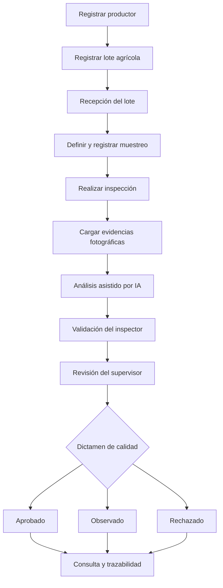

<div align="center">

# 🌱 AgroCloud AI

### Plataforma web para la gestión y trazabilidad de lotes agrícolas con apoyo de inteligencia artificial

**Del registro del productor al dictamen de calidad, en un único flujo de trabajo.**

[](https://laravel.com/)
[](https://www.php.net/)
[](https://www.postgresql.org/)
[](https://livewire.laravel.com/)

[Descripción](#-descripción-general) · [Funcionalidades](#-funcionalidades-principales) · [Flujo](#-cómo-funciona) · [Instalación](#-instalación-local) · [Pruebas](#-pruebas-y-calidad)

</div>

---

## 📖 Descripción general

**AgroCloud AI** es una aplicación web orientada a organizar las operaciones de **recepción, muestreo, inspección y control de calidad de productos agrícolas**. Centraliza los datos de productores, lotes, usuarios y evidencias para que cada etapa tenga un registro consultable y un responsable identificable.

El proyecto incorpora **análisis de fotografías con inteligencia artificial como herramienta de apoyo al inspector**, sin reemplazar su revisión ni la decisión final del supervisor de calidad.

### ¿Qué problema busca resolver?

En procesos agrícolas donde la información se maneja mediante registros dispersos, es difícil conocer el estado de un lote, identificar quién realizó una inspección o consultar las evidencias que respaldaron una decisión. AgroCloud AI busca mejorar esta situación mediante:

- **Centralización:** datos operativos y de calidad en una misma plataforma.
- **Trazabilidad:** seguimiento del lote a lo largo de su recorrido.
- **Control:** permisos diferenciados por función y empresa.
- **Evidencia:** conservación de fotografías y resultados de revisión.
- **Apoyo a decisiones:** detecciones asistidas por IA, validadas por personal autorizado.
- **Consulta y seguimiento:** reportes operativos, incidencias y notificaciones.

## 👥 ¿A quién está dirigido?

A organizaciones que necesitan registrar y supervisar el recorrido de sus lotes agrícolas, especialmente a los equipos de recepción, inspección, control de calidad y administración.

| Perfil | Participación en el sistema |
| --- | --- |
| **Administrador de empresa** | Administra información de su empresa, usuarios, catálogos y procedimientos autorizados según sus permisos. |
| **Responsable de recepción** | Revisa los lotes y registra su recepción. |
| **Inspector** | Registra muestreos, inicia inspecciones, carga fotografías y valida los resultados del análisis. |
| **Supervisor** | Revisa las inspecciones y emite dictámenes de calidad. |
| **Personal de producción** | Consulta información operativa y reportes habilitados para su función. |
| **Superadministrador** | Accede a funciones de administración global de empresas, usuarios y solicitudes de acceso. |

> **Importante:** las pantallas y operaciones disponibles dependen del rol y de los permisos asignados. El acceso a datos operativos está delimitado por empresa.

## ✨ Funcionalidades principales

| Módulo | ¿Qué permite hacer? |
| --- | --- |
| **Panel principal** | Consultar información general y acceder a las funciones habilitadas. |
| **Empresas y acceso** | Gestionar empresas, solicitudes de acceso, invitaciones y activación de cuentas. |
| **Usuarios, roles y permisos** | Organizar las responsabilidades de cada persona y controlar los accesos. |
| **Productores** | Registrar, consultar y actualizar datos de los productores. |
| **Lotes agrícolas** | Registrar lotes, asociarlos con productores y consultar su información y estado. |
| **Recepciones** | Confirmar la recepción de lotes y registrar datos de la operación. |
| **Procedimientos de muestreo** | Administrar procedimientos por empresa, con instrucciones y versiones. |
| **Muestreos** | Seleccionar un lote recibido y documentar la muestra que se inspeccionará. |
| **Inspecciones y evidencias** | Registrar inspecciones y fotografías asociadas a las muestras. |
| **Análisis con IA** | Enviar imágenes al servicio de detección y mostrar resultados para revisión. |
| **Validación y hallazgos** | Confirmar o descartar detecciones, revisar imágenes y registrar observaciones. |
| **Dictámenes de calidad** | Documentar la evaluación del supervisor y su decisión. |
| **Trazabilidad e incidencias** | Consultar el recorrido del lote y dar seguimiento a incidencias. |
| **Reportes y notificaciones** | Consultar indicadores operativos, exportar reportes en CSV y recibir avisos dentro del sistema. |
| **Catálogos maestros** | Mantener opciones reutilizables que estandarizan los formularios. |

### 🤖 ¿Qué hace la inteligencia artificial?

El sistema integra un servicio externo de detección de imágenes a través de una API. En términos sencillos:

1. El inspector registra una fotografía como evidencia de la inspección.
2. La aplicación almacena la imagen en **Cloudinary**.
3. El servidor Laravel envía la imagen al servicio de IA mediante una solicitud autenticada.
4. Se registran las detecciones devueltas por el servicio.
5. El inspector revisa la pertinencia de la imagen y **confirma o descarta** las detecciones.
6. El supervisor utiliza las evidencias revisadas junto con el resto de la información para emitir un dictamen.

**La IA es una ayuda técnica, no un sustituto del criterio profesional.** Su disponibilidad depende de la configuración del servicio y de las credenciales correspondientes.

## 🔄 Cómo funciona

El recorrido principal se resume en el siguiente diagrama:



**Ejemplo de uso:** una empresa registra un productor y el lote que recibirá. Tras confirmar la recepción, un inspector selecciona el lote, aplica un procedimiento de muestreo, captura fotografías y revisa los resultados de IA. Posteriormente, el supervisor evalúa el expediente y registra su dictamen. Los usuarios con permisos pueden consultar el estado y la información histórica correspondiente.

## 🧩 Tecnologías y arquitectura

| Componente | Tecnología / enfoque |
| --- | --- |
| Backend | **PHP 8.3 o superior** y **Laravel 13** |
| Interfaz | Plantillas **Blade**, **Livewire 4** y **Tailwind CSS 4** |
| Compilación frontend | **Vite 8** y Node.js / npm |
| Base de datos | **PostgreSQL**; configuración local disponible con SQLite |
| Gestión de imágenes | **Cloudinary**, mediante integración desde Laravel |
| Inteligencia artificial | API de detección externa, consumida desde el backend Laravel |
| Consulta de RUC | Proveedor externo configurable que consulta información relacionada con el padrón SUNAT |
| Pruebas | **PHPUnit**, pruebas de frontend de Node.js y **Playwright** |
| Integración continua | **GitHub Actions**, con generación de evidencias e informes QA |

La aplicación concentra las reglas de negocio, la autenticación y la autorización en Laravel. Las integraciones externas se consumen desde el servidor, evitando incorporar sus claves privadas en el código del navegador.

> La validación de RUC utiliza un **proveedor intermediario configurable**. No debe describirse como una conexión directa oficial con SUNAT ni como garantía de verificación permanente.

## 🚀 Instalación local

### Requisitos previos

- **PHP 8.3 o superior**, con extensiones habituales de Laravel y el controlador de la base de datos elegida (`pdo_sqlite` o `pdo_pgsql`).
- **Composer**.
- **Node.js 22** y npm (recomendados para reproducir el entorno de CI).
- **Git**.
- **SQLite** para una configuración local sencilla, o **PostgreSQL** para un entorno equivalente al de las pruebas de integración.

### 1. Clonar el repositorio

```bash
git clone https://github.com/ilanangelesrodriguez/agrocloud.git
cd agrocloud
```

Para trabajar específicamente con la rama de desarrollo documentada:

```bash
git switch feature/ilan
```

> El repositorio es **privado**: la clonación requiere permisos de acceso en GitHub.

### 2. Instalar dependencias

```bash
composer install
npm ci
```

### 3. Preparar el archivo de entorno

En Linux o macOS:

```bash
cp .env.example .env
php artisan key:generate
```

En PowerShell, la copia equivalente es `Copy-Item .env.example .env`.

### 4. Configurar la base de datos

**Opción A — SQLite (inicio local rápido)**

El archivo `.env.example` viene preparado inicialmente para SQLite:

```dotenv
DB_CONNECTION=sqlite
```

Crea el archivo `database/database.sqlite` si aún no existe. En Linux/macOS:

```bash
touch database/database.sqlite
```

**Opción B — PostgreSQL**

Ajusta el archivo `.env` a los datos de una base propia de desarrollo:

```dotenv
DB_CONNECTION=pgsql
DB_HOST=127.0.0.1
DB_PORT=5432
DB_DATABASE=agrocloud
DB_USERNAME=postgres
DB_PASSWORD=tu_clave_local
```

La base de datos indicada debe existir y PHP debe tener habilitada la extensión PostgreSQL. En servicios administrados puede requerirse SSL o una URL de conexión específica.

### 5. Ejecutar migraciones e inicialización

```bash
php artisan migrate
php artisan db:seed
```

Los *seeders* configuran empresas, roles, permisos y cuentas de demostración cuando corresponde. Las nuevas credenciales de prueba se generan aleatoriamente y se guardan **solo en el entorno local**, en:

```text
storage/app/private/agrocloud-seed-users-credentials.txt
```

No publiques este archivo ni lo envíes al repositorio. Para crear o actualizar un administrador inicial mediante variables de entorno puedes utilizar `AGROCLOUD_ADMIN_EMAIL` y `AGROCLOUD_ADMIN_PASSWORD` **con valores privados**, definidos antes de ejecutar los *seeders*.

> ⚠️ **Precaución:** la inicialización mediante `db:seed` genera cuentas de demostración, incluida una cuenta para el rol global si aún no existe. Úsala únicamente en una base de desarrollo o pruebas controlada. No ejecutes `migrate:fresh` en una base con información que quieras conservar: ese comando elimina las tablas y las reconstruye. Revisa y respalda la base antes de aplicar migraciones a entornos existentes.

### 6. Compilar los recursos y levantar el sistema

En una terminal:

```bash
npm run dev
```

En otra terminal:

```bash
php artisan serve
```

Abre **http://127.0.0.1:8000**. También puedes usar un puerto explícito:

```bash
php artisan serve --host=0.0.0.0 --port=8001
```

Si usas Codespaces o un servidor remoto, abre el puerto correspondiente desde la interfaz de tu entorno.

## ⚙️ Integraciones opcionales

El funcionamiento básico de registro y consulta puede evaluarse sin configurar todos los servicios externos. Para habilitar funciones adicionales, configura los valores requeridos en el archivo `.env` o en las variables secretas del proveedor de despliegue.

| Variable | Finalidad |
| --- | --- |
| `CLOUDINARY_URL` | Permite subir y administrar evidencias fotográficas. |
| `AGROCLOUD_AI_API_KEY` | Autoriza las solicitudes del backend al servicio de análisis de imágenes. |
| `RUC_API_URL` / `RUC_API_KEY` | Habilitan la consulta del RUC mediante el proveedor configurado. |
| `MAIL_MAILER` y variables de correo | Permiten enviar invitaciones, avisos y recuperación de contraseñas. |
| `AGROCLOUD_ADMIN_EMAIL` / `AGROCLOUD_ADMIN_PASSWORD` | Permiten configurar una cuenta de administración inicial al ejecutar la inicialización. |

En `.env.example`, el correo está configurado inicialmente en modo `log`, por lo que **no envía mensajes reales** hasta que se configure un transporte válido. Mantén siempre `APP_DEBUG=false` en producción y no compartas claves, contraseñas ni archivos `.env`.

## ✅ Pruebas y calidad

AgroCloud AI incorpora un flujo de aseguramiento de la calidad mediante **GitHub Actions**, con verificaciones de dependencias y sintaxis, pruebas unitarias, frontend, base de datos PostgreSQL, seguridad, recorridos de navegador y evidencias visuales.

Comandos de uso habitual en desarrollo:

```bash
# Pruebas de Laravel
php artisan test

# Pruebas del frontend
npm test

# Compilación de recursos
npm run build

# Pruebas E2E (requieren la preparación del entorno de Playwright)
npm run test:e2e
```

El flujo completo de CI se encuentra en [`.github/workflows/qa-pipeline.yml`](.github/workflows/qa-pipeline.yml) y se ejecuta con cambios en `feature/ilan` o manualmente desde GitHub Actions. Utiliza una **base PostgreSQL de pruebas independiente** para los escenarios que reconstruyen tablas; las credenciales de dicha base se suministran mediante secretos de GitHub.

Al finalizar, el workflow puede publicar el artefacto **`agrocloud-informe-qa`**, que reúne reportes y evidencias disponibles para su revisión. La presencia de estas pruebas **no implica que todas las ejecuciones hayan resultado exitosas**: consulta el estado de cada ejecución en [GitHub Actions](https://github.com/ilanangelesrodriguez/agrocloud/actions).

## 🗂️ Estructura del proyecto

```text
agrocloud/
├── app/
│   ├── Http/Controllers/    # Endpoints y operaciones del sistema
│   ├── Livewire/            # Componentes interactivos
│   ├── Models/              # Entidades y relaciones del negocio
│   └── Services/            # Lógica de servicios e integraciones
├── config/                  # Configuración de la aplicación
├── database/
│   ├── migrations/          # Cambios de estructura de la BD
│   └── seeders/             # Datos y configuración inicial
├── resources/views/         # Pantallas y componentes Blade
├── routes/                   # Rutas agrupadas por módulo
├── tests/                    # Pruebas Laravel, frontend y E2E
├── scripts/qa/               # Generación y validación de informes
├── .github/workflows/        # Automatización de calidad
├── .env.example              # Ejemplo de configuración sin secretos
└── README.md                 # Documentación general del proyecto
```

## 🔐 Seguridad y buenas prácticas

- Las páginas de operación requieren **autenticación, cuentas activas y permisos**.
- La gestión de datos se realiza según el contexto de la **empresa asociada al usuario**.
- Las acciones sensibles disponen de validaciones y comprobaciones de autorización.
- Los resultados de la IA se someten a **validación humana** antes del dictamen.
- Las claves de bases de datos, proveedores externos y correo deben conservarse fuera del repositorio.
- Las migraciones, los *seeders* y los flujos de QA que reconstruyen datos deben ejecutarse únicamente sobre los entornos previstos.

## 🌐 Despliegue

El proyecto dispone de configuración para despliegues basados en contenedores o servicios compatibles con PHP/Laravel, y contempla el uso de una base PostgreSQL administrada. Antes de publicar una instancia, configura las variables de entorno del proveedor, una base de datos propia, el almacenamiento de evidencias y un servicio de correo real si se necesitan notificaciones por email.

**No reutilices bases de pruebas, contraseñas de demostración ni credenciales locales en producción.** Comprueba también el dominio de `APP_URL`, la configuración HTTPS, las migraciones pendientes y el funcionamiento de las integraciones externas.


## 👨‍💻 Repositorio y mantenimiento

- **Proyecto:** AgroCloud AI
- **Repositorio:** [ilanangelesrodriguez/agrocloud](https://github.com/ilanangelesrodriguez/agrocloud)
- **Incidencias y seguimiento:** [GitHub Issues](https://github.com/ilanangelesrodriguez/agrocloud/issues) (requiere acceso al repositorio)

Para proponer mejoras, crea una rama de trabajo, documenta el cambio, ejecuta las pruebas que correspondan y abre un *pull request* para revisión.

---

<div align="center">

**AgroCloud AI — Gestión agrícola organizada, trazable y respaldada por evidencias.**

</div>
